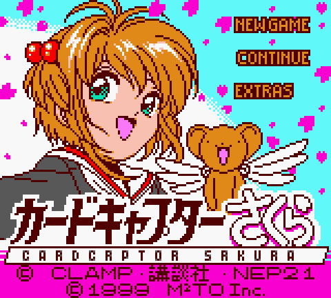
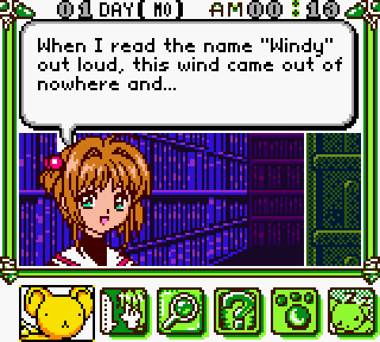
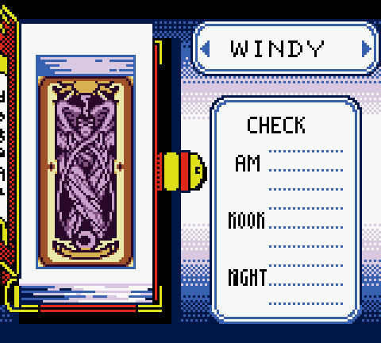
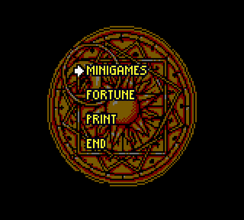
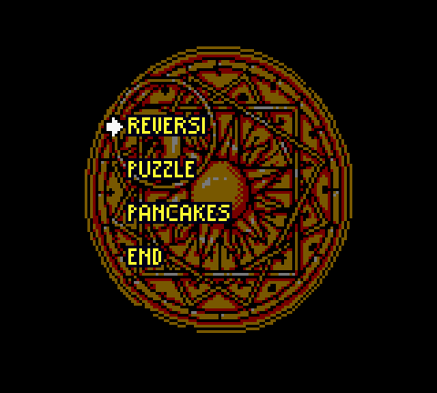
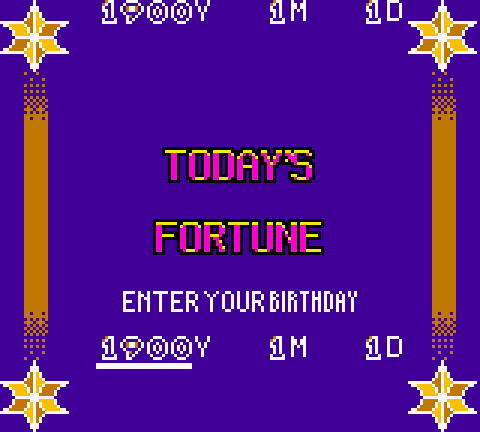
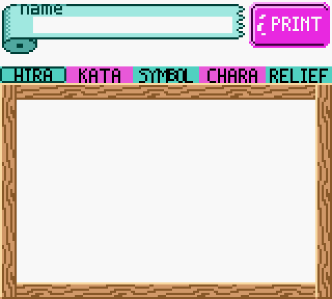
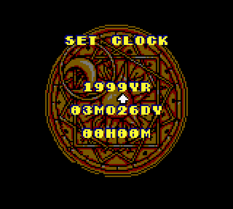

# Cardcaptor Sakura: Itsumo Sakura-chan to Issho — English Translation (Game Boy Color)

An English fan translation patch for **Cardcaptor Sakura: Itsumo Sakura-chan to Issho** (カードキャプターさくら いつもさくらちゃんと一緒), released for the Game Boy Color in 1999 (MTO / Kodansha).

**This is a machine (AI-assisted) translation, not a professional or human translation.** Wording may be imperfect. Reports and corrections are welcome via [GitHub issues](https://github.com/pacocyborg/cardcaptor-sakura-gbc-english/issues).

**Version:** 1.0

## Screenshots

| Title menu | Dialogue |
|---|---|
|  |  |
| **Select / Clow Card list** | **Extras** |
|  |  |
| **Minigames** | **Fortune teller** |
|  |  |
| **Print Play** | **Set Clock** |
|  |  |

## What's translated

- The full player-visible story script (~2,800 strings)
- Title menu (New Game / Continue / Extras)
- HUD and the Set Clock screen
- Extras and minigame menus (Reversi, Puzzle, Pancakes, Fortune, Print)
- Select / Clow Card list (card names and Check / AM / Noon / Night labels)
- Fortune teller UI (Today's Fortune, birthday entry, Y/M/D)
- Print Play (Print badge and tab labels)
- Episode title cards and staff credits

## Engine work

- A variable-width (proportional) Latin font so English dialogue fits the boxes naturally
- ROM expanded from 512 KB to 1 MB (cartridge type is unchanged: MBC3 + RTC + battery)
- Interrupt stability fix so the game does not reset during play

## Known remaining Japanese

- The original Japanese title logo is unchanged (an English "CARDCAPTOR SAKURA" banner already sits beneath it)
- The 講談社 credit in the copyright bar
- Fortune result category labels (e.g. あいじょう / おかね / けんこう)
- Some staff credit wording is abbreviated to fit the original slots
- A few menu numerals
- Debug / sound-test menus that the game never normally shows

## How to patch

You need your own copy of the original Japanese ROM. **No ROMs are provided here.**

Base ROM: `Cardcaptor Sakura - Itsumo Sakura-chan to Issho (Japan)`

| | |
|---|---|
| Size | 524,288 bytes (512 KiB) |
| CRC32 | `89ba58ed` |
| MD5 | `049da443c6bd96a0365cbc68b7d0e2eb` |
| SHA-1 | `8a11954329dcabe4bb39cb522505545a41da5356` |

Apply `Cardcaptor Sakura - Itsumo Sakura-chan to Issho (English v1.0).ips` with:

- [Floating IPS (Flips)](https://github.com/Alcaro/Flips)
- [ROM Patcher JS](https://www.marcrobledo.com/RomPatcher.js/)

The patch expands the ROM from 512 KB to 1 MB. Use a patcher that supports IPS size changes (Flips and ROM Patcher JS both do).

Patched ROM:

| | |
|---|---|
| Size | 1,048,576 bytes (1 MiB) |
| CRC32 | `58e5376a` |
| MD5 | `7b1e620a648921a35626f7a77bd559ac` |
| SHA-1 | `e706a85215a88274d94c3996aefe4863ac81e647` |

## Playing tips

This is a real-time clock game: events happen at set hours of the day.

On Day 1, talk to Sakura in her room between 1–3 PM and 6–8 PM.

Time-shift trick: start a New Game, set the clock to the time you want, then press A+B+Start+Select to return to the title screen and choose Continue.

A detailed unofficial event guide is available on [GameFAQs](https://gamefaqs.gamespot.com/gbc/571691-cardcaptor-sakura-itsumo-sakura-chan-to-issho/faqs/10637).

## Recommended emulators

- [Mednafen](https://mednafen.github.io/) (tested)
- [SameBoy](https://sameboy.github.io/) (tested)

Not yet tested on real Game Boy Color / Game Boy Advance hardware. If you try it on a flash cart, bug reports are welcome.

## Credits

- **Paco** ([@pacocyborg](https://github.com/pacocyborg) on GitHub, [@PacoCyborg](https://x.com/PacoCyborg) on X) — patch and hacking

## Disclaimer

This is an unofficial fan translation made for fun. It is not affiliated with, endorsed by, or sponsored by CLAMP, Kodansha, NEP21, MTO, or any rights holders. No ROMs or copyrighted game data are distributed — only a patch. Please support the official releases.
